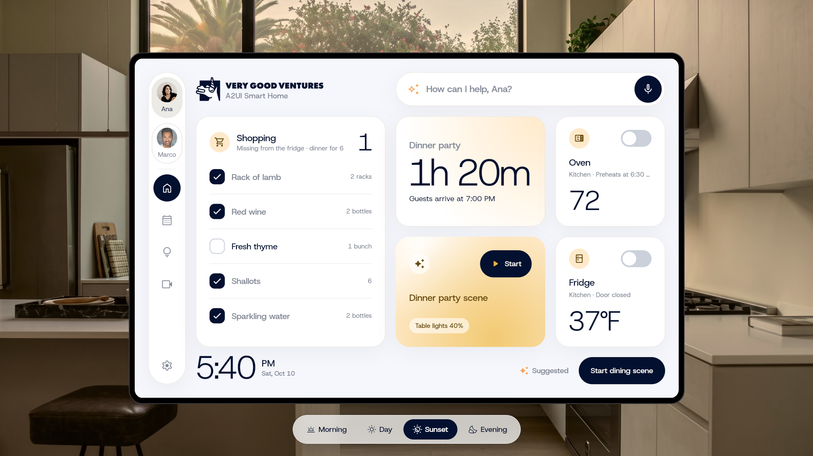

<h1 align="center">A2UI VGV Smart Home</h1>

<p align="center">
  A wall-mounted smart home panel where GenUI composes an A2UI dashboard for each family member.
</p>

<p align="center">
  <a href="https://a2ui-vgv-smart-home.web.app"><strong>Try the live demo</strong></a>
</p>

<p align="center">
  
</p>

The panel helps a household coordinate its plans and devices. GenUI composes a different dashboard for each family member, side by side, rather than one static screen.

## Layers

Dependencies point down only. A bloc never reads another bloc.

```
Presentation   lib/<feature>/view/            widgets, pages
Business logic lib/<feature>/cubit/           cubits (LiveCubit, TimelineCubit, UsersCubit, VoiceCubit)
Repository     packages/home_repository       Users / Scenario / Live repositories
Data           packages/home_api_client       HomeApiClient: HTTP + `/live` socket
   ── network ──
Backend        packages/home_backend          Dart Frog: LLM via Genkit, tools, mock world
```

Side packages, imported only through their barrel (never `src/`):

- `packages/home_catalog`: pure Dart. The components the model may emit, plus the prompt. No `genui` import.
- `packages/home_frontend`: one widget builder per catalog component, the zone controller, `HttpGenUIAgent`.
- `packages/app_ui`: design tokens and the home widgets the builders draw.
- `packages/home_timeline`: scenario clock and activity feed.

Start at `lib/app/view/app.dart` (wiring), `packages/home_repository/lib/src/`, `packages/home_backend/lib/runtime.dart`.

## Validation

The model's reply is untrusted. Validation runs at every hop.

- **Prompt**: the catalog schemas and card sizes are rendered into the system prompt (`SystemPrompt`), so the model is told only what exists.
- **Backend, per reply** (`lib/validation/`), built from `homeCatalog`:
  - `A2uiEnvelopeValidator`: a well-formed A2UI message, not prose.
  - `CatalogComponentValidator`: only declared components.
  - `LayoutValidator`: the screen is on the grid (see Layout).
  - `LayoutComposer` mends an off-grid layout in code before the validators run.
- **One retry**: errors go back to the model as a user turn. If it still fails, the route answers `422`. Statuses: `400` bad body, `401` no key, `422` validation, `502` model failure.
- **Frontend**: `GenerateResponse` throws `FormatException` on an off-contract body. `StableSurface` rejects a reply with no `root` or a dangling child id before the renderer sees it. `buildCatalog` fails at startup if a component has no builder.
- **Bring your own key**: the Gemini key lives only in the request and is never logged (`lib/gemini_key/`).

Start at `packages/home_backend/lib/generate/generate_handler.dart`, `packages/home_backend/lib/validation/`, `packages/home_frontend/lib/src/queue/stable_surface.dart`.

## Streaming

There are three channels. The model reply itself is **not** streamed.

```
POST /generate, /action   buffered JSON reply, validated, then returned     (model turn)
WS   /live                server pushes clock, a2ui, inbox, changed (data changes)
WS   /transcribe          audio up, text down, via Gemini Live              (voice)
```

- **Why the reply is buffered**: it lets the route return a real status code (a `422` or `502`) instead of a committed `200`. `HttpGenUIAgent` posts to it and gets the whole A2UI message list.
- **Turn queue** (`packages/home_frontend/lib/src/queue/turn_queue.dart`): runs presses and typed or spoken turns one at a time. It stands in for the ordered agent stream of A2UI 1.0. The model writes a whole dashboard each turn, but `StableSurface` addresses every message to one surface id, so the renderer sees `updateComponents` on one live surface and rebuilds in place.
- **Live updates without the model**: a device changes, the backend publishes an `a2ui` frame (`updateDataModel`) on `/live`. `LiveCubit.surfaceMessages` forwards it, `GenUIAgent.apply` puts it on the surface, and bound cards change in place. `HttpGenUIAgent` replays the newest update per path after a reply lands, so a stale reply never wins.
- **`changed` frames** make a screen ask again (`refresh`). The queue drops or folds a refresh while a user turn is running.
- **Voice**: `VoiceCubit` streams microphone audio to `/transcribe`, and the text goes to the LLM like a typed turn.

Start at `packages/home_backend/lib/live/live_session.dart`, `packages/home_frontend/lib/src/agent/http_genui_agent.dart`, `lib/live/cubit/live_cubit.dart`, `lib/voice/cubit/voice_cubit.dart`.

## Layout

One declaration of size, used three times.

```
GenUiComponent.fit (CardFit)    packages/home_catalog/lib/src/components/card_fit.dart
   ├─ prompt   renderCardFits → layout.prompt tells the model each card's spans
   ├─ backend  LayoutValidator rejects any other span
   └─ frontend grid_layout.dart draws each card at exactly that cell
```

- **The grid**: 12 columns by 2 rows. A card's width is its `weight` (columns spanned). Rows are 1 (half) or 2 (full height).
- **A screen** is a root `Column` of one or two `Row`s, or one `Row` holding a full-height card plus `Column` bands of up to two cards, ending with `ActionChips`. Each `Row`'s weights add up to 12.
- **Nothing is dropped or stretched** in the renderer. Anything off the grid is rejected earlier, by the validator.
- **Adding a card**: set its `fit` once and never write a size into a prompt by hand. The six steps are in `packages/home_catalog/AGENTS.md`.
- **The zone** is the region the LLM draws into: `GenUIZoneController` accumulates items, `GenUIZoneView` renders them, and `MemberDashboard` hosts it (`lib/dashboard/view/`).

Start at `packages/home_catalog/lib/src/components/card_fit.dart`, `packages/home_backend/lib/validation/layout_validator.dart`, `packages/home_frontend/lib/src/catalog/grid_layout.dart`, `packages/home_backend/assets/layout.prompt`.

Mock data lives in `packages/home_backend/data/` and the model reaches it through the tools in `packages/home_backend/lib/tools/agent_tools.dart`. Each package's `AGENTS.md` has the details for changing it.

## Run locally

You need:

- [mise](https://mise.jdx.dev), which installs the pinned Flutter and runs the tasks in `mise.toml`.
- very_good_cli (`dart pub global activate very_good_cli`) for the tests and license check.
- The Dart Frog CLI (`dart pub global activate dart_frog_cli`) for the backend.
- Chrome and an LLM API key.

### 1. Set up

The Flutter version is pinned in `mise.toml`, and CI reads the same pin. From the repo root:

```bash
mise trust
mise install
mise run setup
```

`mise install` installs the pinned Flutter, and Node for the spell check. `mise run setup` fetches every package's dependencies. The mise tasks always run the pinned SDK. Outside a task, run `flutter` and `dart` through `mise exec --`, or [activate mise](https://mise.jdx.dev/getting-started.html#activate-mise) in your shell so the pinned SDK is first on `PATH` inside the repo. To point an IDE at the SDK, use the path `mise where flutter` prints.

`mise run check` runs the same checks as CI. See [Tests](#tests).

### 2. Backend

```bash
cd packages/home_backend
cp example.env .env
```

Fill in `.env`:

- `HOME_CORS_ALLOWED_ORIGINS=http://localhost:3000`, so the web app can call the API.

There is no API key to set. The demo is bring your own key: when the app opens it asks for a [Gemini API key](https://aistudio.google.com/apikey) and sends it with each request. The server uses it for that request and never stores it, so nothing about a key belongs in `.env`.

If you work across several worktrees, put the filled-in `.env` in the directory above the worktree instead. `mise run dev:backend` and `mise run dev` copy it into any worktree that has no `packages/home_backend/.env` of its own. A worktree's own `.env` always wins, so after you edit the shared file, delete a worktree's copy to pick up the change.

Then start it:

```bash
mise run dev:backend
```

The server listens on `http://localhost:8080` and reloads when a file changes. Check it with `curl localhost:8080/health`.

### 3. App

From the repo root:

```bash
cp config.example.json config.json
```

Fill in `config.json`. `GENUI_BACKEND_URL` should point at the backend. That is all it holds.

As with `.env`, you can put `config.json` in the directory above the worktree instead. `mise run dev:app` and `mise run dev` copy it into any worktree that has no `config.json` of its own, and a worktree's own copy always wins.

Then run:

```bash
mise run dev:app
```

The app opens in Chrome on port 3000, which is the origin the backend allows. If something else holds 3000, set `GENUI_APP_PORT` and add the new origin to `HOME_CORS_ALLOWED_ORIGINS` in `.env`. In VS Code, the "Launch app" configuration does the same.

`mise run dev` starts the backend in the background and the app in the foreground in one terminal. The keys there go to `flutter run`, and quitting the app stops the backend too.

To speak a command, tap the microphone in the ask bar. A card opens and listens until you pause, tap the microphone again, or tap Cancel to drop it. Ten seconds of silence closes it. The backend's `/transcribe` streams the audio to the [Gemini Live API](https://ai.google.dev/api/live) and its transcription model, `gemini-3.5-transcribe-live`, with your Gemini key. The text goes to the LLM like any other turn. Browsers only allow the microphone on `localhost` or over HTTPS.

When the app opens it shows a popup asking for your Gemini API key. The key stays in memory in that browser tab, so reloading the page asks again. The settings button in the sidebar reopens the popup to change it.

Each visitor also gets a demo world of their own on the backend: the clock, devices and household you change are not seen by anyone else. The app makes a random session id when it opens and sends it with each request, so reloading starts a fresh world.

## Tests

```bash
mise run test          # every package, each at its CI coverage floor
mise run test:backend  # one package
```

The per-package tasks are `test:app`, `test:app_ui`, `test:frontend`, `test:catalog`, `test:timeline`, `test:api_client`, `test:repository` and `test:backend`. To run tests by hand from inside a package, use `mise exec -- flutter test` for the app, `app_ui` and `home_frontend`, and `mise exec -- dart test` for the rest.

`mise run check` runs the CI checks across every package: format, analyze, bloc lint, tests at each package's coverage floor, the license check, and the Markdown spell check. It leaves out the PR title checks, and the Dart packages test on the Dart that ships with the pinned Flutter rather than the version CI pins. `mise tasks` lists each check on its own.

CI runs the app, backend and packages as separate workflows in `.github/workflows/`.

## Deploy

`.github/workflows/deploy.yaml` runs on every push to `main`. It deploys the backend to Cloud Run, then builds the web app and deploys it to Firebase Hosting. GitHub authenticates to Google Cloud through Workload Identity Federation, so no service account key is stored. A fork needs these repository variables:

| Variable | What it holds |
| --- | --- |
| `GCP_PROJECT_ID` | The Google Cloud project for Cloud Run and Firebase Hosting. |
| `GCP_REGION` | The Cloud Run region, for example `us-central1`. |
| `WIF_PROVIDER` | The Workload Identity provider's full resource name. |
| `WIF_SERVICE_ACCOUNT` | The service account the workflow deploys as. |
| `FIREBASE_SITE` | The Firebase Hosting site to deploy the app to. |
| `CORS_ALLOWED_ORIGINS` | The app's origins, comma separated, passed to the backend as `HOME_CORS_ALLOWED_ORIGINS`. |

It also needs one secret: `APP_CONFIG_JSON`, the app's `config.json`. The workflow overwrites `GENUI_BACKEND_URL` in it with the Cloud Run URL.

## License

Apache License 2.0, see `LICENSE`. Third-party notices are in `NOTICE`.
