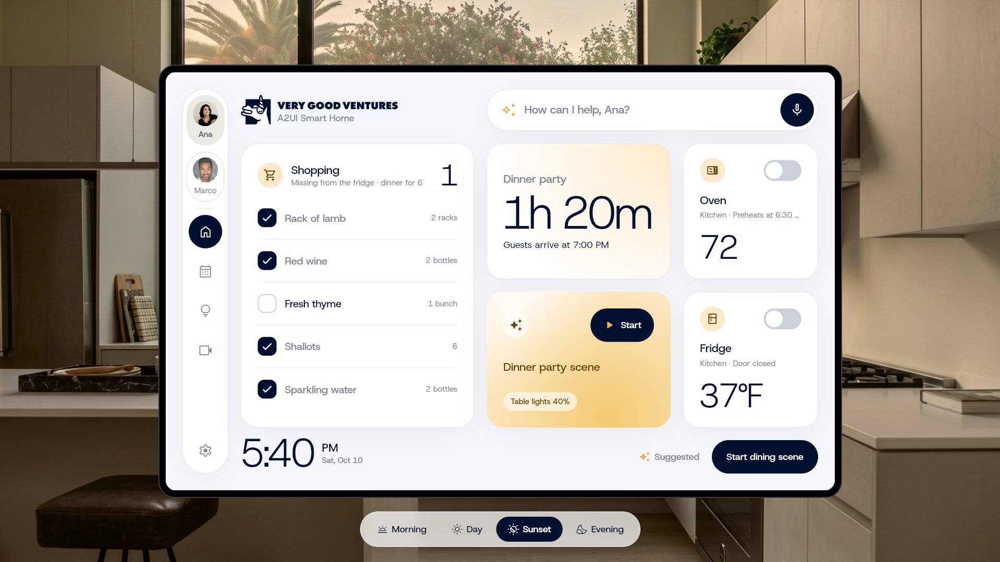

<h1 align="center">A2UI VGV Smart Home</h1>

<p align="center">
  A wall-mounted smart home panel where GenUI composes an A2UI dashboard for each family member.
</p>

<p align="center">
  <a href="https://a2ui-vgv-smart-home.web.app"><strong>Try the live demo</strong></a>
</p>

<p align="center">
  
</p>

The panel helps a household coordinate its plans and devices. GenUI composes a different dashboard for each family member, side by side, rather than one static screen.

## How it works

The model never draws pixels. It writes a JSON description of a screen: a list of A2UI 1.0 messages. The app already knows how to draw a fixed menu of cards (the catalog), so the model can only pick from that menu and arrange the cards. Think of the model as an interior designer ordering from a catalog, and Flutter as the builder who assembles the order.

Three A2UI messages carry everything:

| Message | Meaning |
| --- | --- |
| `createSurface` | "Here is a new screen, with its components and data." |
| `updateComponents` | "Change the layout." |
| `updateDataModel` | "Change this one value." Cards bound to an `@path` update in place. |

The key split is structure versus data. A card doesn't contain "oven: 180°C". It contains "show whatever is at `/devices/oven/temp`". Changing a number never means rebuilding a screen.

### Example: "preheat the oven for dinner"

1. **The user speaks.** `VoiceCubit` streams microphone audio over `/transcribe` and gets text back. The text goes to the LLM like a typed turn.
2. **The turn queue.** `TurnQueue` (`packages/home_frontend/lib/src/queue/turn_queue.dart`) runs presses and typed or spoken turns one at a time, because A2UI orders messages only within one stream.
3. **The request.** The frontend sends `POST /generate`, and attaches `metadata.a2uiRendererDataModel` from a surface created with `sendDataModel`. Its surface ids tell the stateless backend that the `dashboard` surface exists, so the model updates it instead of creating it.
4. **The backend thinks.** The model reads the prompt, may call tools over the mock household data, and replies with A2UI JSON, roughly:

   ```json
   [
     {"updateDataModel": {"path": "/devices/oven", "value": {"target": 200}}},
     {"updateComponents": {"components": [
       {"id": "oven_card", "component": "DeviceCard", "weight": 6},
       {"id": "chips", "component": "ActionChips"}
     ]}}
   ]
   ```

   The first turn is one `createSurface` that carries the components and the data model. Later turns are `updateDataModel` then `updateComponents` on the same surface.
5. **Validation.** The checks in Validation run. A bad reply gets one retry.
6. **The reply lands.** `HttpGenUIAgent` applies every message in one `processMessages` call, so the panel never shows half a grid.
7. **Live updates, no model.** The device state machine changes, and the backend publishes an `a2ui` frame on `/live`:

   ```json
   {"updateDataModel": {"path": "/devices/oven/temp", "value": 143}}
   ```

   `LiveCubit.surfaceMessages` forwards it, `GenUIAgent.apply` puts it on the surface, and the bound oven card redraws its number in place. The seed that came with the dashboard uses the same device paths.

After a reply lands, `HttpGenUIAgent` replays the newest update per path, so a slow, stale reply never overwrites a fresher temperature.

Tapping a button works the same way, through `POST /action` instead of `/generate`. The backend applies the tap to the device first, then asks the model what the screen should do next.

## Features

Three ideas make the flow above safe and fast: **streaming** keeps live values moving without the model, **validation** stops a bad reply from reaching the panel, and **layout** keeps every card on a grid the model can't break.

### Streaming

The model decides what is on screen. It is slow, validated and arrives in one piece. A2UI data bindings and `/live` decide what the numbers say. They are fast, streamed and need no model.

There are three channels:

```
POST /generate, /action   buffered JSON {messages, reply}, validated          (model turn)
WS   /live                server pushes clock, a2ui, inbox, changed (data changes)
WS   /transcribe          audio up, text down, via Gemini Live              (voice)
```

The dashboard is not streamed. The route answers `{messages, reply}` once the reply is checked, so it can return a real status code (a `422` or `502`) instead of a committed `200`. Streaming is for live data.

### Validation

The model's reply is untrusted, so it is checked before it reaches the panel.

- **Ask for less**: the prompt is built from the catalog, so the model is told only what exists.
- **Check the reply**: the backend rejects anything that is not valid A2UI 1.0, uses an unknown component, or doesn't fit the grid (see Layout).
- **Try once more**: on a failure the errors go back to the model once. If it fails again, the route answers `422`. Other statuses: `400` bad body, `401` no key, `502` model failure.
- **Apply all or nothing**: the app applies the messages in one call, and if the renderer refuses one, the panel stays as it was.

### Layout

The panel is a grid of 12 columns by 2 rows. Each card declares its size once, and three places read that one declaration:

```
GenUiComponent.fit (CardFit)    packages/home_catalog/lib/src/components/card_fit.dart
   ├─ prompt   tells the model each card's size
   ├─ backend  LayoutValidator rejects any other size
   └─ frontend grid_layout.dart draws each card in exactly that space
```

So the model can only ask for sizes that exist, and nothing is ever stretched or dropped on screen.

## Layers

Dependencies point down only. A bloc never reads another bloc.

```
Presentation   lib/<feature>/view/            widgets, pages
Business logic lib/<feature>/cubit/           cubits (LiveCubit, TimelineCubit, UsersCubit, VoiceCubit)
Repository     packages/home_repository       Users / Scenario / Live repositories
Data           packages/home_api_client       HomeApiClient: HTTP + `/live` socket
   ── network ──
Backend        packages/home_backend          Dart Frog: LLM via Genkit, tools, mock world
```

Side packages, imported only through their barrel (never `src/`):

- `packages/home_catalog`: pure Dart. The components the model may emit, plus the prompt. No renderer import.
- `packages/home_frontend`: one widget builder per catalog component, the zone controller, `HttpGenUIAgent`.
- `packages/app_ui`: design tokens and the home widgets the builders draw.
- `packages/home_timeline`: scenario clock and activity feed.

## Run locally

You need:

- [mise](https://mise.jdx.dev), which installs the pinned Flutter and runs the tasks in `mise.toml`.
- very_good_cli (`dart pub global activate very_good_cli`) for the tests and license check.
- The Dart Frog CLI (`dart pub global activate dart_frog_cli`) for the backend.
- Chrome and an LLM API key.

### 1. Set up

The Flutter version is pinned in `mise.toml`, and CI reads the same pin. From the repo root:

```bash
mise trust
mise install
mise run setup
```

`mise install` installs the pinned Flutter, and Node for the spell check. `mise run setup` fetches every package's dependencies. The mise tasks always run the pinned SDK. Outside a task, run `flutter` and `dart` through `mise exec --`, or [activate mise](https://mise.jdx.dev/getting-started.html#activate-mise) in your shell so the pinned SDK is first on `PATH` inside the repo. To point an IDE at the SDK, use the path `mise where flutter` prints.

`mise run check` runs the same checks as CI. See [Tests](#tests).

### 2. Backend

```bash
cd packages/home_backend
cp example.env .env
```

Fill in `.env`:

- `HOME_CORS_ALLOWED_ORIGINS=http://localhost:3000`, so the web app can call the API.

There is no API key to set. The demo is bring your own key: when the app opens it asks for a [Gemini API key](https://aistudio.google.com/apikey) and sends it with each request. The server uses it for that request and never stores it, so nothing about a key belongs in `.env`.

If you work across several worktrees, put the filled-in `.env` in the directory above the worktree instead. `mise run dev:backend` and `mise run dev` copy it into any worktree that has no `packages/home_backend/.env` of its own. A worktree's own `.env` always wins, so after you edit the shared file, delete a worktree's copy to pick up the change.

Then start it:

```bash
mise run dev:backend
```

The server listens on `http://localhost:8080` and reloads when a file changes. Check it with `curl localhost:8080/health`.

### 3. App

From the repo root:

```bash
cp config.example.json config.json
```

Fill in `config.json`. `GENUI_BACKEND_URL` should point at the backend. That is all it holds.

As with `.env`, you can put `config.json` in the directory above the worktree instead. `mise run dev:app` and `mise run dev` copy it into any worktree that has no `config.json` of its own, and a worktree's own copy always wins.

Then run:

```bash
mise run dev:app
```

The app opens in Chrome on port 3000, which is the origin the backend allows. If something else holds 3000, set `GENUI_APP_PORT` and add the new origin to `HOME_CORS_ALLOWED_ORIGINS` in `.env`. In VS Code, the "Launch app" configuration does the same.

`mise run dev` starts the backend in the background and the app in the foreground in one terminal. The keys there go to `flutter run`, and quitting the app stops the backend too.

To speak a command, tap the microphone in the ask bar. A card opens and listens until you pause, tap the microphone again, or tap Cancel to drop it. Ten seconds of silence closes it. The backend's `/transcribe` streams the audio to the [Gemini Live API](https://ai.google.dev/api/live) and its transcription model, `gemini-3.5-transcribe-live`, with your Gemini key. The text goes to the LLM like any other turn. Browsers only allow the microphone on `localhost` or over HTTPS.

When the app opens it shows a popup asking for your Gemini API key. The key stays in memory in that browser tab, so reloading the page asks again. The settings button in the sidebar reopens the popup to change it.

Each visitor also gets a demo world of their own on the backend: the clock, devices and household you change are not seen by anyone else. The app makes a random session id when it opens and sends it with each request, so reloading starts a fresh world.

## Tests

```bash
mise run test          # every package, each at its CI coverage floor
mise run test:backend  # one package
```

The per-package tasks are `test:app`, `test:app_ui`, `test:frontend`, `test:catalog`, `test:timeline`, `test:api_client`, `test:repository` and `test:backend`. To run tests by hand from inside a package, use `mise exec -- flutter test` for the app, `app_ui` and `home_frontend`, and `mise exec -- dart test` for the rest.

`mise run check` runs the CI checks across every package: format, analyze, bloc lint, tests at each package's coverage floor, the license check, and the Markdown spell check. It leaves out the PR title checks, and the Dart packages test on the Dart that ships with the pinned Flutter rather than the version CI pins. `mise tasks` lists each check on its own.

CI runs the app, backend and packages as separate workflows in `.github/workflows/`.

## Deploy

`.github/workflows/deploy.yaml` runs on every push to `main`. It deploys the backend to Cloud Run, then builds the web app and deploys it to Firebase Hosting. GitHub authenticates to Google Cloud through Workload Identity Federation, so no service account key is stored. A fork needs these repository variables:

| Variable | What it holds |
| --- | --- |
| `GCP_PROJECT_ID` | The Google Cloud project for Cloud Run and Firebase Hosting. |
| `GCP_REGION` | The Cloud Run region, for example `us-central1`. |
| `WIF_PROVIDER` | The Workload Identity provider's full resource name. |
| `WIF_SERVICE_ACCOUNT` | The service account the workflow deploys as. |
| `FIREBASE_SITE` | The Firebase Hosting site to deploy the app to. |
| `CORS_ALLOWED_ORIGINS` | The app's origins, comma separated, passed to the backend as `HOME_CORS_ALLOWED_ORIGINS`. |

It also needs one secret: `APP_CONFIG_JSON`, the app's `config.json`. The workflow overwrites `GENUI_BACKEND_URL` in it with the Cloud Run URL.

## License

Apache License 2.0, see `LICENSE`. Third-party notices are in `NOTICE`.
